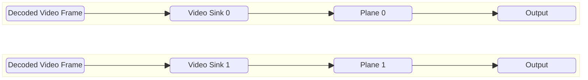
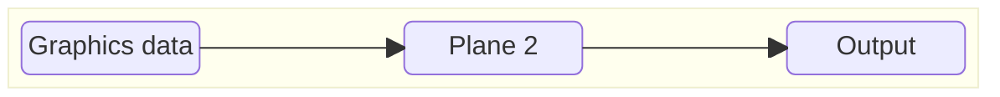

# Plane Control High Level Test Specification Document

## Table of Contents

- [Acronyms, Terms and Abbreviations](#acronyms-terms-and-abbreviations)
- [Introduction](#introduction)
- [Module Description](#module-description)
- [Video Playback Specification](#video-playback-specification)
- [Graphics Plane Test Application](#graphics-plane-test-application)
- [vsyncDisplayLatency Measurement](#vsyncdisplaylatency-measurement)
- [Video Plane Geometry Specification](#video-plane-geometry-specification)
- [L2 Test Specification](#l2-test-specification)
- [L3 Test Specification](#l3-test-specification)

## Acronyms, Terms and Abbreviations

- `HAL`    - Hardware Abstraction Layer
- `API`    - Application Programming Interface
- `AIDL`   - Android Interface Definition Language
- `L2`     - Level 2 Testing
- `L3`     - Level 3 Testing
- `NA`     - Not Applicable
- `Caller` - Any user of the interface via the `APIs`
- `CB`     - Call-back function (suffix)
- `RDK`    - Reference Design Kit

## Introduction

This document provides an overview of the testing requirements for the Plane Control module. It outlines the scope of testing, objectives, testing levels and approaches, specific test requirements.

Plane Control Interface Definitions - [Plane Control HAL](https://github.com/rdkcentral/rdk-halif-aidl/tree/0.7.0/planecontrol/current)

## Module Description

The Plane Control `HAL` service provides the interfaces for the video frame queue and deliver video frames to a video plane under the timing of the vendor AV sync.

## Video Playback Specification

Plane control supports 3 types of Video sources
Supported source types and its indices are provided in [configuration YAML](../../profiles/hfp-planecontrol.yaml)

* HDMI
* Composite
* Video Sink

Follow the below steps to playback required video using each source

|Source|Achieve Video Playback|
|------|----------------------|
|HDMI  |Connect an HDMI capable device to the Sink port. Playback the required Video as per the test requirement e.g: HDR10, SD, HD etc|
|Composite|Connect a Composite capable device to the sink port. Play back the supported/capable videos as per the test requirement.|
|Video Sink| Create a Video pipeline using the AV HAL objects. Play back the streams as specified in the [streams info](https://github.com/rdkcentral/rdk-halif-binder-test-videodecoder/blob/feature/issues4_Create_HLT/doc/pages/VideoDecoder_TestStreamsInfo.md) document as required for the test.|

## L2 Test Specification

|Test|Description|HAL APIs|
|----|-----------|--------|
|Set and Get Plane Control Properties|<ul><li>get platform capabilities using `getCapabilities` to get list of supported plane indices</li><li>Loop through all the plane indices</li><li>Use the `setProperty` method to set all the supported value provided in [configuration YAML](../../profiles/hfp-planecontrol.yaml) for all plane resource indices</li><li>Get the property value using `getProperty` of `IPlaneControl` and verify the HAL returns the set Value form the YAML file</li></ul>|<ul><li>IPlaneControl - getCapabilities,setProperty, getProperty </li></ul>|
|Set and Get Multiple Plane Control Properties|<ul><li>get platform capabilities using `getCapabilities` to get list of supported plane indices</li><li>Loop through all the plane indices</li><li>Prepare Key value pair of the available properties</li><li>Use the `setPropertyMultiAtomic` method to set all the supported value provided in [configuration YAML](../../profiles/hfp-planecontrol.yaml) for all plane resource indices</li><li>Get the property value using `getPropertyMulti` of `IPlaneControl` and verify the HAL returns the set Value form the YAML file</li></ul>|<ul><li>get platform capabilities using `getCapabilities` to get list of supported plane indices</li><li>Loop through all the plane indices</li><li>IPlaneControl - getCapabilities,setPropertyMultiAtomic, getPropertyMulti </li></ul>|
|Video Source-Plane Mapping verification|<ul><li>get platform capabilities using `getCapabilities` to get list of supported plane indices</li><li>Loop through all of the video plane indices</li><li>Set a Video source to the Video plane using `setVideoSourceDestinationPlaneMapping`</li><li>verify the video source and plane mapping using `getVideoSourceDestinationPlaneMapping`</li></ul>|<ul><li>IPlaneControl - getCapabilities, setVideoSourceDestinationPlaneMapping, getVideoSourceDestinationPlaneMapping </li></ul>|

## L3 Test Specification

### Prerequisites

#### Video Sink

Video frames are supplied to the Plane Control during testing, which necessitates a pre-validated AVBuffer module, Video Decoder and Video Sink. Therefore,AVBuffer, Video Decoder, Video Sink must successfully pass VTS L1, L2, and L3 testing before being used in the Plane Control tests

#### Graphics Plane Test Application

To Validate the Graphics plane we need to create an EGL sample app which will provide the graphics plane data to VTS. This could be an application which  draws a simple triangle to the plane.

_TBD: EGL a separate Binary or Within VTS binary so that VTS has control over what it draws ?_

#### vsyncDisplayLatency Measurement

_TBD: How to measure the time delay between presenting the frame to displayed_

#### Video Plane Geometry Specification

Video Plane can be set to different size and shapes by setting following properties of the planes

<li>X</li><li>Y</li><li>WIDTH</li><li>HEIGHT</li>

|GEOMETRY|Property Values|
|--------|---------------|
|Full Screen| Set `X=0`, `Y=0`, `HEIGHT = frame Height from capabilities`, `WIDTH = frame width from capabilities`|
|Side By Side| <li>1st Plane `X=0`, `Y=0`, `HEIGHT = frameHeight`, `WIDTH = frameWidth/2`</li><li>2nd Plane `X=frameWidth/2`, `Y=0`, `HEIGHT = frameHeight`, `WIDTH = frameWidth/2`</li>|
|PIP Window| <li>1st Plane `X=0`, `Y=0`, `HEIGHT = frameHeight`, `WIDTH = frameWidth`</li><li>2nd Plane `X=3*frameWidth/4`, `Y=frameHeight/4`, `HEIGHT = frameHeight/4`, `WIDTH = frameWidth/4`</li>|
|3X4 plane window|Set `X=frameHeight/8`, `Y=0`, `HEIGHT = frameHeight`, `WIDTH = 3*frameHeight/4`|
#### Graphics Application

Graphics data is supplied by any graphics application which can render basic shape/color to the plane.

### Feature List

VTS L3 validates all the Plane Control features in multiple planes (if the platform supports multiple planes) as represented below.

#### Video Render
To render the video frames from Video buffer to Display, we use plane control to map the video sink to respective frame.

#### Graphics Render
To Render graphics object to the display we can use graphics plane available in plane control module. We can get the graphics window handle from the plane control to provide graphics data to the module.

The following table outlines the core features validated in the L3 test phase

|#|Testing Feature|Description|
|-|---------------|-----------|
|1|Plane Mapping|Map the source with the available planes for rendering on to the display|
|2|Plane Swapping|Swap the source provided in planes to check all the planes rendered can be mapped with different sources|
|3|Aspect Ratio| To set the aspect ratio of the pane to render the video frames in its proper format|
|4|Z order| Plane Z order in which the planes are rendered in to the display|
|5|Visibility| To set and verify the Visibility of the plane rendered |
|6|Over scan| To Set the zoom mode for the plane rendering the video frame.|
|7|Alpha| To set and verify the transparency (Alpha) value for the planes|
|8|Plane position|To set and verify the positioning of the planes |
|9|Plane size|To set and Verify the plane Size |
|10|Dynamic Range|To set the Supported Dynamic range property for the planes |
|11|pixel format|To set and verify the pixel resolution supported by the plane to display the video frame properly.|
|12|graphics Window Handle| To get the Graphics window handle to set graphical element to display|
|13|vsyncDisplayLatency|To read and verify the vsync Display Latency value |

### Test Cases

The table below summarizes the L3 test cases executed using various audio stream formats and configurations. These tests are also executed in a multi-process environment:

|#|Test|Mapping|Swapping|Aspect Ratio|Z Order|Visibility|over scan|Alpha|Plane Position|Plane Size|Dynamic Range|Pixel Format|Graphics Window|vsync Latency|
|-|----|------|------|-------------|----|-------------|---|-----|----------|-----------|-----|-----|----|----|
|1| planecontrol_mapping |✔|✘|✘|✘|✘|✘|✘|✘|✘|✘|✘|✘|✘|
|2| planecontrol_swapping|✔|✔|✘|✘|✘|✘|✘|✘|✘|✘|✘|✘|✘|
|3| planecontrol_aspectratio|✔|✘|✔|✘|✘|✘|✘|✘|✘|✘|✘|✘|✘|
|4| planecontrol_zorder|✔|✘|✘|✔|✘|✘|✘|✘|✘|✘|✘|✘|✘|
|5| planecontrol_visibility|✔|✘|✘|✘|✔|✘|✘|✘|✘|✘|✘|✘|✘|
|6| planecontrol_overscan|✔|✘|✘|✘|✘|✔|✘|✘|✘|✘|✘|✘|✘|
|7| planecontrol_Aplpha|✔|✘|✘|✘|✘|✘|✔|✘|✘|✘|✘|✘|✘|
|8| planecontrol_position|✔|✘|✘|✘|✘|✘|✘|✔|✘|✘|✘|✘|✘|
|8| planecontrol_size|✔|✘|✘|✘|✘|✘|✘|✘|✔|✘|✘|✘|✘|
|8| planecontrol_dynamicrage|✔|✘|✘|✘|✘|✘|✘|✘|✘|✔|✘|✘|✘|
|8| planecontrol_resolution|✔|✘|✘|✘|✘|✘|✘|✘|✘|✘|✔|✘|✘|
|8| planecontrol_graphics|✔|✘|✘|✘|✘|✘|✘|✘|✘|✘|✘|✔|✘|
|8| planecontrol_vsync|✔|✘|✘|✘|✘|✘|✘|✘|✘|✘|✘|✘|✔|

